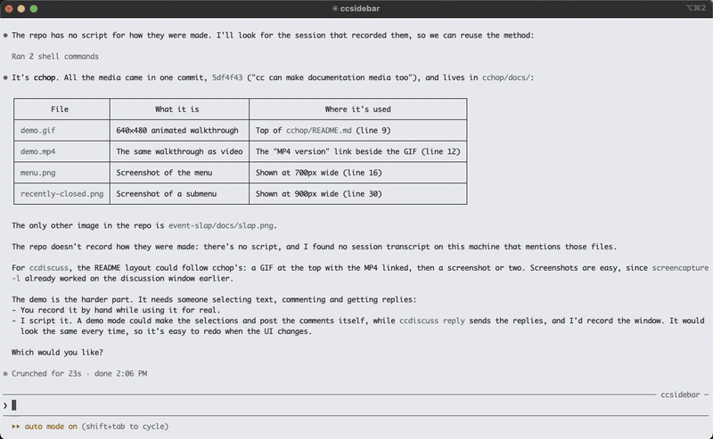
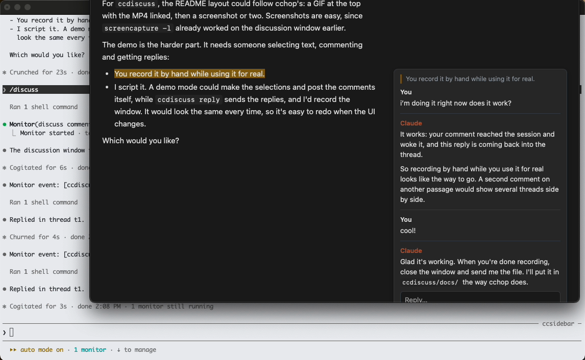
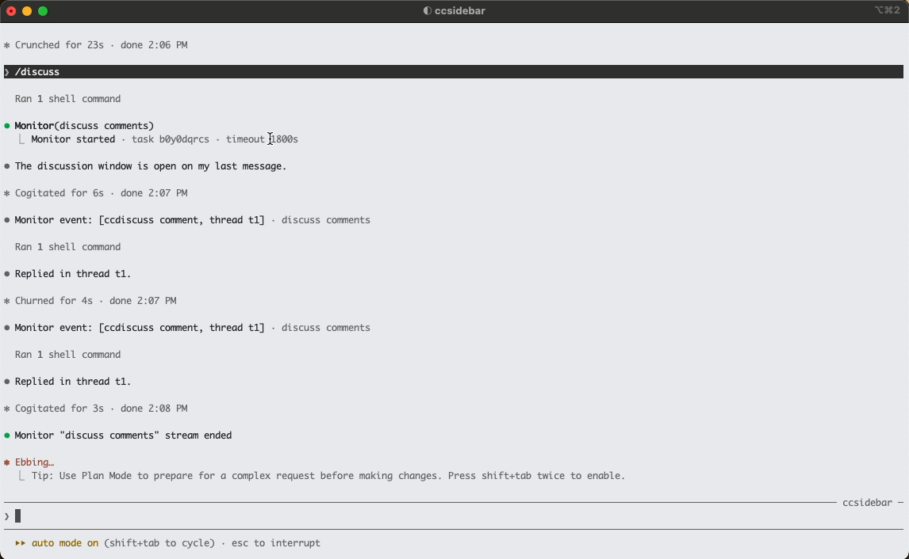

# ccdiscuss

`/discuss`: respond to parts of a long Claude Code response the way you would
in a Google Doc. Highlight a passage, comment, and the running Claude session
answers in that thread.



<sub>Type `/discuss`, highlight a passage, comment, read Claude's reply, follow
up, close the window. ([MP4 version](docs/demo.mp4).)</sub>

It replaces the habit of replying with

```
> quoted text like this
my thoughts here...
```

for several passages at once, which makes it easy to lose track of which
points you've covered. Each comment reaches the session in that same form.



In the terminal, each comment shows up as a Monitor event and each reply as
one short line:



Status: first version, tested end to end in a live session. Comments woke the
idle session, replies showed up in their threads, and closing the window
ended the watch.

## Install

```
uv tool install --editable ~/ai2/jasond-slop/ccdiscuss    # puts `ccdiscuss` on your PATH
ln -s ~/ai2/jasond-slop/ccdiscuss/skill/discuss ~/.claude/skills/discuss
```

Then type `/discuss` in any session, right after a response you want to pick
apart.

## Flow

1. Claude gives a long response.
2. `/discuss` opens a separate native window (not a browser tab) showing the
   final text block of that response, meaning the text after the last tool
   call, rendered as markdown.
3. Highlight any range and comment. Each comment goes to the **same running
   session** (no forks), so every thread shares the full history and sees the
   other threads. Claude always replies in the thread, even just to say it
   saw the comment.
4. You can keep using the terminal while the window is open. Permission
   prompts show up there as usual.
5. Close the window when you're done. If the threads settled on changes
   Claude hasn't made yet, it lists them and offers to make them. Otherwise
   you just keep using Claude normally.

### Comments aren't approvals

Claude Code labels every Monitor event as "not user input", and nothing in
ccdiscuss can change that. The label exists so that text from a background
process can't pose as you. So a comment works for discussion and for ordinary
work, but it can't count as your go-ahead for something like a commit or a
push. Give those in the terminal; the offer on close is the natural place.

Comment text also arrives HTML-escaped (`>` shows up as `&gt;`). That's a
little noisy, but readable.

Nothing is saved: no per-thread resolve state and no discussion files. Once
the window closes, the comments and replies live only in the session's
history.

## How the pieces connect

```
 ┌──────────── ccdiscuss window (pywebview) ────────────┐
 │  comment ──▶ appends to outbox.jsonl                 │
 │  reply   ◀── watches inbox.jsonl                     │
 └──────────────────────────────────────────────────────┘
        │ outbox                         ▲ inbox
        ▼                                │
 Monitor: `ccdiscuss watch`       Bash: `ccdiscuss reply <thread>`
        │  one event per comment         ▲
        └──────▶  Claude session  ───────┘
```

There is no HTTP server and no port. The window and the session pass messages
through two files in a temporary directory.

- **Open**: the skill runs `ccdiscuss open ${CLAUDE_SESSION_ID}`. It pulls the
  last assistant text block from
  `~/.claude/projects/<project>/<session-id>.jsonl`, makes the temporary
  directory and launches the window as a detached process.
- **Comments in**: Claude runs `Monitor` on `ccdiscuss watch <dir>`, which
  prints one line per new comment. Each line wakes the session. A comment
  arrives as the thread id plus the quote-and-reply form shown above; the
  session already has the rest of the context.
- **Replies out**: `ccdiscuss reply <dir> <thread>` reads markdown from stdin
  and appends it to the inbox file, and the window shows it in the thread.
- **Close**: the window writes `closed` to the outbox and exits. `watch` then
  exits too, which ends the Monitor.

### Dispatch

How comments queue and get delivered is meant to be iterated on. The starting
point:

- comments that arrive while Claude is busy wait their turn;
- a watch lasts at most 30 minutes, so when it expires the skill restarts it,
  and `watch` re-sends comments that have no reply yet.

### Why not something else

- **`claude -p --resume`**: starts a separate process. It doesn't add turns to
  the live session.
- **Channels**: a custom one only loads if the session was started with
  `--dangerously-load-development-channels`.
- **Monitor**: any session can use it, so it's what `/discuss` relies on.

## Stack

- Python, run with uv like the other tools in this repo.
- [pywebview](https://pywebview.flowrl.com/) for the window. It uses the
  system web view, so the window is native and gets its own Dock icon, with no
  Chrome involved. Page events reach Python through the pywebview JavaScript
  bridge, so no server is needed.
- Page: plain HTML and JavaScript with no build step. Vendored libraries:
  - `markdown-it` for GitHub-flavored markdown;
  - `highlight.js` for code blocks;
  - `DOMPurify` to sanitize the rendered HTML.
- Highlights: anchored by the quoted text plus a little surrounding text, and
  drawn with the CSS Custom Highlight API so the rendered markdown is never
  rewritten. Thread cards sit in the right margin next to their passage.

## Layout

```
ccdiscuss/
  pyproject.toml
  src/ccdiscuss/      cli.py (open / watch / reply), window.py, transcript.py
  src/ccdiscuss/static/   index.html, app.js, style.css, vendor/ (pinned copies)
  skill/discuss/SKILL.md   symlinked into ~/.claude/skills/discuss
  docs/               README demo and screenshots
```
